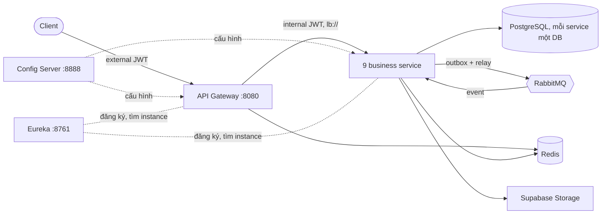

# 🚀 IELTSPath

Backend microservices cho nền tảng học IELTS: **Java 21 / Spring Boot 3.5 / Spring Cloud**. Client chỉ đi qua API Gateway. Mỗi business service sở hữu một database PostgreSQL riêng, gọi nhau bằng HTTP nội bộ (có resilience) và bằng sự kiện RabbitMQ (transactional outbox).

---

## 🏗️ Kiến Trúc Tổng Quan



| Nhóm | Module | Vai trò |
| :-- | :-- | :-- |
| `infra/` | `api-gateway` :8080, `config-server` :8888, `eureka-server` :8761 | Ingress WebFlux, cấu hình tập trung (`config-repo/`), service registry |
| `shared/` | `common-security`, `common-events`, `common-resilience`, `common-observability`, `common-storage`, `common-llm` | Thư viện dùng chung, tự cấu hình bằng Spring Boot auto-configuration, không deploy độc lập |
| `services/` | `user` :8085, `content` :8082, `library` :8081, `assessment` :8083, `access` :8084, `learning` :8086, `game` :8087, `notification` :8088, `community` :8089 | Business service, mỗi service một bounded context và một database |

Reactor Maven gồm 18 module (3 infra, 6 shared, 9 business). Kiến trúc chi tiết, luồng nghiệp vụ và quyết định thiết kế: [`docs/system-architecture.md`](docs/system-architecture.md).

---

## 🧩 Các Pattern Hệ Thống Dùng

Chỉ liệt kê pattern đã có trong code. Cột "Xem" trỏ tới nơi đọc tiếp.

### Biên hệ thống và cấu hình

| Pattern | Cách áp dụng | Xem |
| :-- | :-- | :-- |
| **API Gateway** | Một điểm vào: xác thực external JWT, định tuyến `lb://`, CORS, timeout theo route, chặn `/internal/**` | `infra/api-gateway` |
| **Service Discovery** | Service đăng ký với Eureka; Gateway và client tìm instance qua tên service | `infra/eureka-server` |
| **Centralized Configuration** | Config Server dạng native đọc `config-repo/*.yaml`; giá trị đổi theo môi trường dùng `${VAR:default}` | `infra/config-server` |
| **Token exchange tại biên** | User Service ký external JWT; Gateway kiểm rồi ký **internal JWT** ngắn hạn (~60 giây) cho downstream. Downstream chỉ tin internal JWT, không tin header `X-User-*` | `shared/common-security`, mục 4 của system-architecture |
| **Rate limiting (token bucket qua Redis)** | Tier `auth`, `upload`, `ai`, `default` theo subject JWT hoặc IP. Redis lỗi: request thường đi tiếp, login trả 503 (fail-closed) | `config-repo/api-gateway.yaml` |

### Cấu trúc trong service và dữ liệu

| Pattern | Cách áp dụng | Xem |
| :-- | :-- | :-- |
| **Database per service + Flyway** | Mỗi service một DB, migration `V<n>__<mô_tả>.sql` chạy khi khởi động, không sửa migration đã áp | `services/*/src/main/resources/db/migration` |
| **DDD + Clean Architecture** | `api` → `application` (mỗi use case một class `*UseCase`) → `domain`; `infrastructure` giữ JPA, adapter, client, messaging | mục 5 của system-architecture |
| **Repository Adapter, Mapper, Ports & Adapters** | Domain không phụ thuộc JPA; entity JPA ánh xạ bằng MapStruct; client, outbox, khóa đi qua `application/port` | `services/learning-service`, `assessment-service` |
| **Lỗi thống nhất** | `GlobalExceptionHandler` đổi exception thành `ErrorResponse` | mỗi service, gói `api/exception` |
| **Object storage trừu tượng** | `ObjectStorage` + adapter Supabase, khóa object được kiểm tra, file PREMIUM phát bằng URL ký 900 giây | `shared/common-storage` |

### Giao tiếp đồng bộ

| Pattern | Cách áp dụng | Xem |
| :-- | :-- | :-- |
| **Circuit Breaker + Retry + Bulkhead** | `ResilientCall` bọc mọi lời gọi HTTP giữa service. Breaker theo service đích (mở 30 giây); retry tối đa một lần sau 200 ms, chỉ cho `READ` và `IDEMPOTENT_WRITE`, chỉ với lỗi kết nối, timeout, 5xx; LLM giới hạn 4 lời gọi đồng thời. Lỗi được đổi về contract lỗi của service gọi | `shared/common-resilience` |
| **Client LLM dùng chung** | Learning, Assessment, Content dùng `common-llm`: luật theo model, lỗi an toàn, timer `llm.call.duration` và counter `llm.tokens`; prompt và parser ở service | `shared/common-llm` |
| **Gọi ngoài transaction** | HTTP và LLM không chạy trong transaction hay khi giữ khóa | mục 3 của system-architecture |

### Giao tiếp bất đồng bộ

| Pattern | Cách áp dụng | Xem |
| :-- | :-- | :-- |
| **Transactional Outbox + Relay** | Event ghi vào `outbox_events` cùng transaction với dữ liệu; relay publish với publisher confirm. Áp dụng ở assessment, access, community và learning (`reward_grants`) | `OutboxRelay*` trong từng service |
| **Retry queue + Dead-letter queue + Replay** | Consumer ack thủ công; lỗi tạm đi qua retry queue có TTL, lỗi contract hoặc hết lượt vào DLQ. Replay gửi lại đúng exchange và routing key gốc (`x-original-routing-key`) | `shared/common-events` (`MessageRetry`, `RetryTopology`) |
| **Idempotent consumer** | Notification chống trùng theo `eventId`; Learning áp kết quả theo `(attempt, result_version)` | listener của notification, learning |
| **Event có version** | Tên exchange, routing key, payload nằm ở `common-events`, có hậu tố `.v1`, `.v2`; đổi event phải đổi contract cùng lúc | `docs/contracts/` |

### Nhất quán và đồng thời

| Pattern | Cách áp dụng | Xem |
| :-- | :-- | :-- |
| **Idempotency-Key** | Cấp Premium (Access) và mở khóa course (Learning) bắt buộc khóa này; gửi lại cùng khóa trả kết quả cũ, khác payload trả conflict | `docs/saga-course-unlock-and-human-grading.md` |
| **Intent bền + đối soát (saga)** | Mở khóa course ghi `PENDING` trước, trừ điểm ở Access bằng cùng khóa, rồi kích hoạt; `ReconcilePendingCourseUnlocks` hoàn tất phần dang dở. Chấm bài người cũng dùng khóa tín dụng ổn định và hoàn điểm khi chắc chắn lỗi | `docs/saga-course-unlock-and-human-grading.md` |
| **Claim hàng bằng `FOR UPDATE SKIP LOCKED`** | Relay outbox, chấm essay, bản nháp AI chạy an toàn trên nhiều instance | mục "Scheduler và nhiều instance" của system-architecture |
| **Advisory lock** | Job định kỳ của learning, publish theo lịch của content, khóa theo user (`LearnerLock`, `AdvisoryUserLock`) | cùng mục trên |
| **Graceful shutdown** | Spring drain 30 giây, scheduler đợi tối đa 20 giây | mục "Dừng một instance" |

### Realtime

| Pattern | Cách áp dụng | Xem |
| :-- | :-- | :-- |
| **WebSocket ticket ngắn hạn** | Game cấp ticket qua REST, lưu Redis có TTL | `services/game-service` |
| **Push sau commit, nguồn dữ liệu là DB** | Notification chỉ đẩy STOMP sau commit; Redis pub/sub là kênh không bền, REST dùng để đồng bộ lại khi reconnect | `services/notification-service` |

### Quan sát

| Pattern | Cách áp dụng | Xem |
| :-- | :-- | :-- |
| **Correlation ID** | `X-Correlation-Id` đi qua HTTP, MDC, cột outbox và header AMQP `x-correlation-id` | `shared/common-observability` |
| **Metrics** | `/actuator/prometheus` trong mạng nội bộ; gauge độ sâu DLQ và outbox | mục "Correlation ID và metric" |
| **Distributed tracing (tùy chọn)** | Micrometer Tracing + OpenTelemetry, mặc định tắt. Trace context lưu cạnh outbox (`trace_context`) và đi qua RabbitMQ bằng `traceparent`. Stack Loki, Tempo, Alloy, Grafana chạy bằng profile `observability` | mục "Tracing và log tập trung" |

### Quy trình

| Pattern | Cách áp dụng | Xem |
| :-- | :-- | :-- |
| **Contract-first** | Hợp đồng endpoint và event nằm trong `docs/contracts/`; đổi hành vi phải cập nhật contract cùng PR | `docs/contracts/` |

---

## 🛠️ Công Nghệ

| Thành phần | Công nghệ |
| :-- | :-- |
| Ngôn ngữ, build | Java 21, Maven 3.9+ (multi-module) |
| Framework | Spring Boot 3.5.14, Spring Cloud 2025.0.0 (Gateway WebFlux, Eureka, Config) |
| Dữ liệu | PostgreSQL 15, Spring Data JPA, Flyway, Redis 7 |
| Messaging | RabbitMQ 3.13 (Spring AMQP) |
| Bảo mật | Spring Security, JWT HMAC, BCrypt |
| Resilience | Resilience4j 2.4.0 |
| Quan sát | Micrometer, OpenTelemetry; Prometheus, Loki, Tempo, Alloy, Grafana (tùy chọn) |
| Lưu file | Supabase Storage |
| Kiểm thử | JUnit 5, Mockito, Testcontainers |
| Chạy | Docker, Docker Compose |

---

## ⚡ Chạy Nhanh

Cần JDK 21, Maven 3.9+ và Docker.

1. Tạo `.env` ở thư mục gốc (đã gitignore). Compose bắt buộc sáu biến: `POSTGRES_PASSWORD`, `REDIS_PASSWORD`, `RABBITMQ_USERNAME`, `RABBITMQ_PASSWORD`, `EXTERNAL_JWT_SECRET`, `GATEWAY_INTERNAL_JWT_SECRET`. Hai secret JWT là Base64, tối thiểu 32 byte.
2. Kiểm cấu hình và khởi chạy toàn stack:

```bash
docker compose config --quiet
docker compose up -d --build
```

3. Mở Gateway `http://localhost:8080`, Swagger `http://localhost:8080/swagger-ui.html`, Eureka `http://localhost:8761`, RabbitMQ UI `http://localhost:15673`. PostgreSQL ở host port `5440`.

Build và test:

```bash
mvn clean compile -DskipTests   # build cả reactor
mvn -B verify                    # test đầy đủ, cần Docker cho Testcontainers
```

Build, biến môi trường, chạy service trên IDE, tài khoản demo, Swagger và stack quan sát: [`docs/local-development.md`](docs/local-development.md).

---

## 📚 Tài Liệu

| Tài liệu | Nội dung |
| :-- | :-- |
| [`docs/system-architecture.md`](docs/system-architecture.md) | Kiến trúc đầy đủ: service, giao tiếp, bảo mật, luồng chính, scheduler, reliability |
| [`docs/local-development.md`](docs/local-development.md) | Build, Docker, Flyway, biến môi trường, tài khoản demo, Swagger |
| [`docs/contracts/`](docs/contracts) | Hợp đồng endpoint và event theo từng tính năng |
| [`docs/saga-course-unlock-and-human-grading.md`](docs/saga-course-unlock-and-human-grading.md) | Idempotency và phục hồi lỗi cho mở khóa course, chấm bài người, cấp Premium |
| [`docs/graphify-setup.md`](docs/graphify-setup.md) | Cài Graphify để duyệt codebase bằng knowledge graph |
| [`AGENTS.md`](AGENTS.md) | Quy tắc bắt buộc cho AI agent và người đóng góp |
| `services/<tên>/README.md` | Endpoint và quy tắc riêng của từng service |

---

## 🌿 Quy Chuẩn Đặt Tên Nhánh

Dạng `<type>/<module>-<mô-tả-ngắn>` hoặc `<type>/<issue-id>-<mô-tả-ngắn>`; chữ thường, không dấu, `kebab-case`, ngắn nhưng rõ ý.

`feature/` tính năng mới · `fix/` sửa bug · `hotfix/` lỗi gấp trên production · `refactor/` cải tổ không đổi hành vi · `chore/` setup, cấu hình, dọn dẹp · `docs/` tài liệu · `test/` kiểm thử · `perf/` hiệu năng · `release/` chuẩn bị phát hành.
