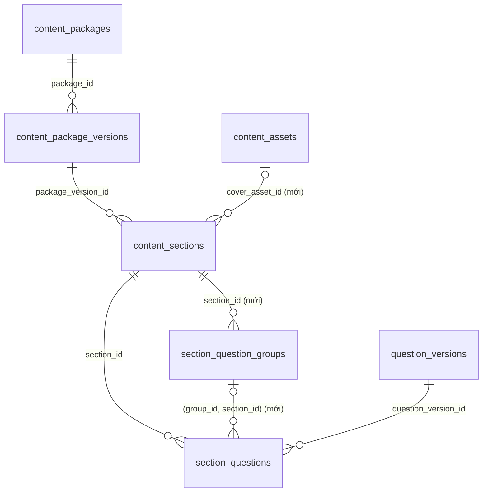
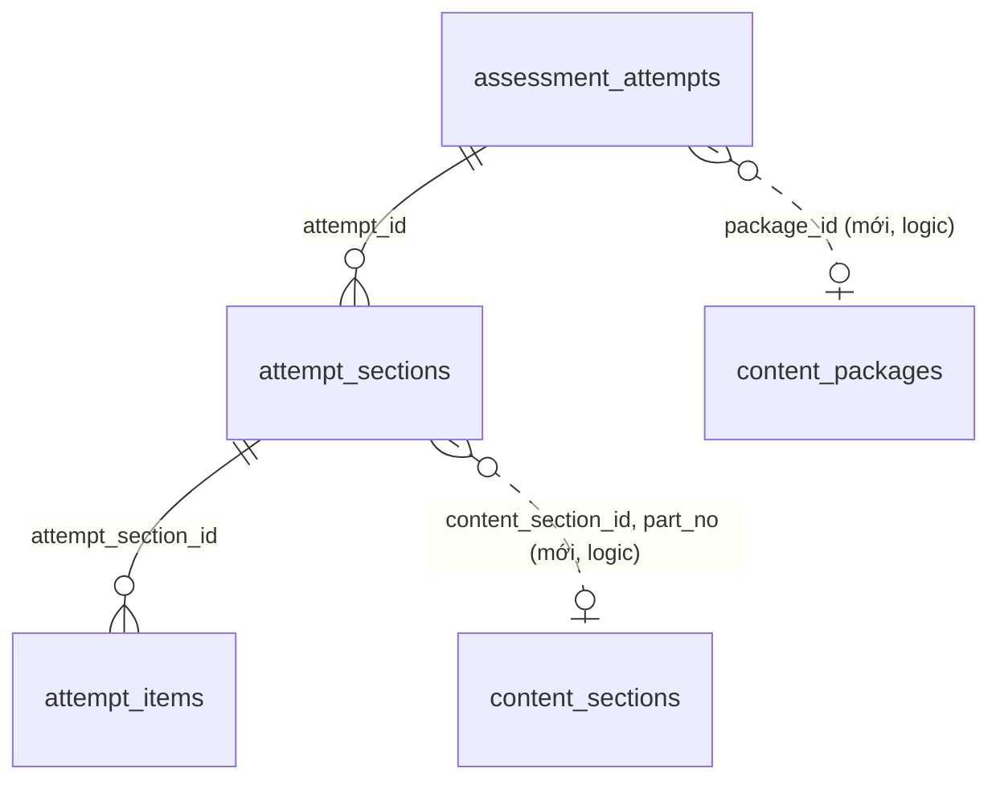

# Mô hình dữ liệu thư viện luyện đề: bảng, cột và quan hệ

## Overview

Plan này là **nguồn duy nhất** cho schema của thư viện luyện đề: bảng nào, cột nào, ràng buộc nào và quan hệ giữa chúng.
Phần code (API, use case, chấm điểm) nằm ở plan [`261014-1002-practice-test-library`](../261014-1002-practice-test-library/plan.md), plan đó
phải đợi plan này (không còn tự định nghĩa DDL).

Màn hình đích: thư viện "LUYỆN ĐỀ The IELTS Space" (mock chủ dự án gửi 2026-10-14): sidebar Reading → Bài lẻ (Passage 1/2/3) / Full đề, lọc **nguồn tài liệu**
(The IELTS Space PRO, C10-C20, Actual Tests, Các nguồn khác), thẻ đề có ảnh bìa, ribbon MIỄN PHÍ/PRO, badge part, ba dòng dạng câu hỏi; tab chưa làm/đã làm; tìm theo tên; phân trang.

Hiện trạng đã kiểm trên DB thật (compose Postgres, content tới V26, assessment tới V7, 2026-10-14):

- `content_packages` 56 dòng: 13 `TOPIC_TEST` (đều có `topic_id`), 4 `COURSE_TEST` (đều có `course_id`), 38 `PRACTICE_SET` (37 có `lesson_id`), 1 `PLACEMENT_TEST`. Không dòng nào có từ hai khóa sở hữu trở lên.
- Không có `MOCK_TEST`; không có câu `purpose = EXAM`; chỉ 1 asset `IMAGE`.
- `content_sections` chưa có số part, ảnh bìa; `section_questions` chưa có khái niệm nhóm; package chưa có nguồn.
- `assessment_attempts` chỉ có `package_version_id` (đề ra version mới thì mất dấu "đã làm"); attempt chưa có phạm vi (cả đề hay một part) và chưa có skill.
- Hai DB không có FK xuyên nhau (`AGENTS.md` §3.5): assessment chỉ giữ tham chiếu logic tới content.

## Giao cho người implement

Base: nhánh `practice_test` @ `ba02556`; lúc lập plan working tree chỉ có thư mục `plans/` chưa theo dõi.

1. Đọc theo thứ tự: `AGENTS.md`, `CLAUDE.md`, `plan.md` này, rồi từng phase. Bảng quyết định là chốt của chủ dự án: **không tự đổi**.
2. Làm trên nhánh `practice_test` (cùng nhánh với plan thư viện đề; plan này đi trước). Mỗi phase một commit conventional
   (`feat(content): ...`, `feat(assessment): ...`). Không ghi mã plan, số phase hay mã quyết định (S1, O1…) vào code, comment, tên test, migration hay commit.
3. TDD: viết test migration đỏ trước, rồi viết migration cho xanh. Lệnh: `mvn -q -pl services/<service> -am test`. Testcontainers cần Docker;
   thiếu Docker thì ghi rõ test nào bị skip, không tuyên bố đã chạy, **và không commit phase có migration**.
4. **Không sửa migration đã áp dụng.** Số migration: content `V28` (`V27` đã là `seed_full_length_placement_test`, chỉ có dữ liệu, không có DDL nên không xung đột), assessment `V8`. Số đã bị dùng khi bắt tay vào làm → dừng, ghi `BLOCKED`.
5. Mọi cột mới nullable hoặc có default; migration **không** `UPDATE`/`DELETE` dữ liệu hiện có. Migration không seed dữ liệu nào.
6. Test cũ đỏ vì migration này: chỉ được sửa kỳ vọng nếu chỉ là con số/danh sách do chính plan này thêm; ghi tên test, kỳ vọng cũ → mới, lý do vào Verification. Khác thế: dừng, ghi `BLOCKED`.
7. Không sửa `third_party/`, `.env`, Docker, config tập trung, Gateway, `common-security`. Không push, không tạo PR.

## Quyết định đã chốt (implementer không được tự đổi)

| # | Quyết định |
| --- | --- |
| S1 | **Chỉ thêm.** Cột mới đều nullable hoặc có default; không đổi/xóa dữ liệu cũ. Code hiện tại chạy được trên schema mới (cột thừa không làm Hibernate `validate` lỗi), nên schema đi trước code an toàn. |
| S2 | Nguồn tài liệu là **một cột** `content_packages.source_code`, không có bảng nguồn. Tập mã hợp lệ, tên hiển thị và thứ tự do enum Java `TestSource` quyết định: `IELTS_SPACE_PRO` "The IELTS Space PRO", `C10_C20` "C10-C20", `ACTUAL_TESTS` "Actual Tests", `OTHER` "Các nguồn khác". Thêm nguồn mới là sửa enum, không cần migration. |
| S3 | `source_code VARCHAR(40)` nullable (56 gói cũ không có nguồn); `CHECK` dạng chữ hoa (`^[A-Z][A-Z0-9_]*$`); `CHECK` một chiều: chỉ gói `PRACTICE_TEST` được có nguồn. Việc "đề luyện phải có nguồn hợp lệ" kiểm lúc publish, không ép ở DB. |
| S4 | Số part nằm ở **section** (`part_no`), duy nhất trong một version khi có giá trị. Định danh một part qua các phiên bản là `(package_id, part_no)`; DB không ép `part_no` giữ nguyên giữa các version, đó là quy ước soạn đề. |
| S5 | Ảnh bìa chỉ ở **section** (`cover_asset_id`); thẻ Full đề dùng ảnh part nhỏ nhất. Không cột ảnh ở package. |
| S6 | Nhóm câu hỏi là bảng `section_question_groups` thuộc section. `section_questions.group_id` nối bằng **khóa ngoại ghép** `(group_id, section_id)` để DB chặn câu hỏi thuộc nhóm của section khác. `format_code` lưu chuỗi; tập giá trị do enum Java quyết định, không liệt kê trong CHECK. |
| S7 | Loại gói mới `PRACTICE_TEST` thêm vào `content_packages_package_type_check` (drop rồi tạo lại, như V20). |
| S8 | Assessment **không có FK** sang content. `assessment_attempts.package_id` là tham chiếu logic tới `content_packages.id`; `attempt_sections.part_no` là bản chụp của `content_sections.part_no`. |
| S9 | `assessment_attempts` thêm `package_id`, `scope` (`FULL`/`PART`, mặc định `FULL`), `skill`. Ràng buộc: `skill` và `scope = PART` chỉ cho `OFFICIAL_PRACTICE`; `OFFICIAL_PRACTICE` mới phải có `package_id` và `skill` (ràng buộc này tạo `NOT VALID` để không quét dòng cũ). |
| S10 | **Không thêm**: bảng nguồn tài liệu (`test_collections`), bảng lượt làm/lịch sử/quy đổi band, cột `skill` ở package, cột ảnh ở package, bảng phụ `practice_test_details`, FK xuyên DB, `pg_trgm`. |

## Sơ đồ quan hệ (phần mới đánh dấu "mới")

content_db:

assessment_db (đường nét đứt là tham chiếu logic, không có FK):

## Bảng quan hệ cần thiết

| Từ | Tới | Kiểu | ON DELETE | Vì sao |
| --- | --- | --- | --- | --- |
| `content_sections.cover_asset_id` | `content_assets.id` | N–1, nullable | NO ACTION | Không xóa được ảnh đang làm bìa. |
| `section_question_groups.section_id` | `content_sections.id` | N–1, bắt buộc | CASCADE | Xóa section thì mất nhóm của nó (giống `section_questions`). |
| `section_questions (group_id, section_id)` | `section_question_groups (id, section_id)` | N–1, nullable (MATCH SIMPLE) | NO ACTION | Câu hỏi chỉ thuộc nhóm **của đúng section nó nằm**; `group_id` rỗng cho câu hỏi cũ. Cần `UNIQUE (id, section_id)` ở bảng nhóm. |
| `assessment_attempts.package_id` | `content_packages.id` | logic, nullable | không FK | Hai DB riêng; "đã làm" không phụ thuộc phiên bản. |
| `attempt_sections.part_no` | `content_sections.part_no` | logic, nullable | không FK | Bản chụp, giữ ổn định kể cả khi content đổi. |

`content_packages.source_code` là cột giá trị thông thường (không có quan hệ): mã nguồn do enum `TestSource` kiểm ở code.

## Phases

| Phase | Name | Status |
|-------|------|--------|
| 1 | [Content schema migration](./phase-01-content-schema-migration.md) | Pending |
| 2 | [Assessment schema migration](./phase-02-assessment-schema-migration.md) | Pending |
| 3 | [Schema docs and verification](./phase-03-schema-docs-and-verification.md) | Pending |

Thứ tự commit: 1 → 2 → 3. Phase 1 và 2 độc lập (hai DB), nhưng cả hai phải xong trước khi plan thư viện đề bắt đầu code.

## Acceptance criteria

- Sau khi chạy hai migration trên DB có dữ liệu hiện tại: `flyway_schema_history` có `28` ở content và `8` ở assessment; số dòng của mọi bảng cũ không đổi;
  `content_packages` vẫn 56 dòng với `source_code` rỗng hết.
- Ràng buộc chặn đúng (có test): gói khác `PRACTICE_TEST` có `source_code` bị từ chối, `source_code` chữ thường bị từ chối; hai section cùng `(package_version_id, part_no)` bị từ chối nhưng cùng `part_no` ở hai version khác nhau được;
  nhiều section `part_no` rỗng cùng version được; câu hỏi gắn nhóm của **section khác** bị từ chối; xóa section kéo theo nhóm và câu hỏi của nó mà không lỗi; xóa nhóm đang có câu hỏi bị chặn;
  `scope = PART` hoặc `skill` ở attempt khác `OFFICIAL_PRACTICE` bị từ chối; attempt `OFFICIAL_PRACTICE` mới thiếu `package_id` hoặc `skill` bị từ chối; attempt cũ vẫn có `scope = FULL`.
- Dịch vụ content và assessment (code hiện tại, chưa sửa entity) khởi động được trên schema mới với `ddl-auto: validate`.
- `.sdd/database/DATABASE_V5.md` mô tả các bảng/cột mới đúng với migration.
- Mọi test content và assessment hiện có vẫn xanh;
  `mvn -q -pl services/content-service,services/assessment-service -am test` xanh.

## Ngoài phạm vi

Entity/mapper/DTO/API/use case (plan thư viện đề) · seed đề mẫu (V29, plan thư viện đề phase 8) · API/bảng quản lý nguồn tài liệu (nguồn nằm trong enum `TestSource`) · bảng lượt làm/lịch sử ·
bảng quy đổi band · đối chiếu lại toàn bộ `DATABASE_V5.md` với V19–V27 · FK xuyên DB · chặn khóa PRO · loại câu "chọn nhiều đáp án" (chỉ đổi `answer_spec` JSON, không đổi bảng).

## Câu hỏi mở (mặc định ghi sẵn)

| # | Câu hỏi | Mặc định nếu không trả lời |
| --- | --- | --- |
| O1 | Tạo index `(package_id, status)` ở `assessment_attempts` (chỉ phục vụ đếm lượt làm bài)? Màn hình đích **không** hiện lượt làm bài. | **Tạo** (index một phần, rẻ), vì phase 4 của plan thư viện đề hiện còn endpoint `stats`. Bỏ nếu chủ dự án xác nhận bỏ đếm lượt làm. |
| O2 | Nhãn "PRO" cạnh tên nguồn "The IELTS Space PRO" có phải dữ liệu? | Trang trí, **không thêm cột** nào; enum `TestSource` không mang cờ PRO. |
| O3 | `part_no` tối đa? | DB chỉ `CHECK (part_no > 0)`; giới hạn 1-4 kiểm lúc publish (plan thư viện đề). |

## Dependencies

- Chặn plan [`261014-1002-practice-test-library`](../261014-1002-practice-test-library/plan.md) (phase 1 và 3 của plan đó chỉ còn phần code, dùng schema của plan này).
- Không chồng lấn plan nào khác đang mở: `261009-1417-practice-gated-lesson-unlock` chỉ đụng Learning; không plan nào giữ số migration content `V28` hay assessment `V8`.

## Verification

(Implementer điền khi làm: lệnh đã chạy, số dòng trước/sau từng bảng, test bị skip vì thiếu Docker, test cũ đã đổi kỳ vọng.)
